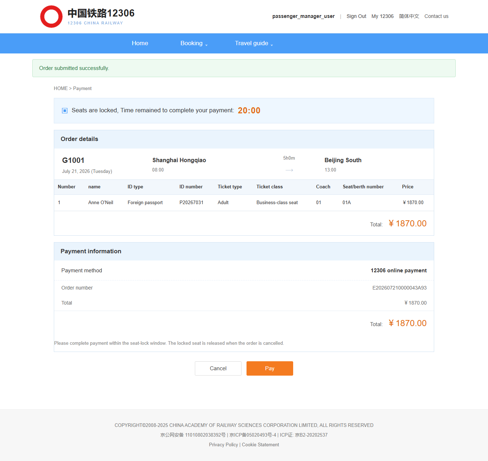
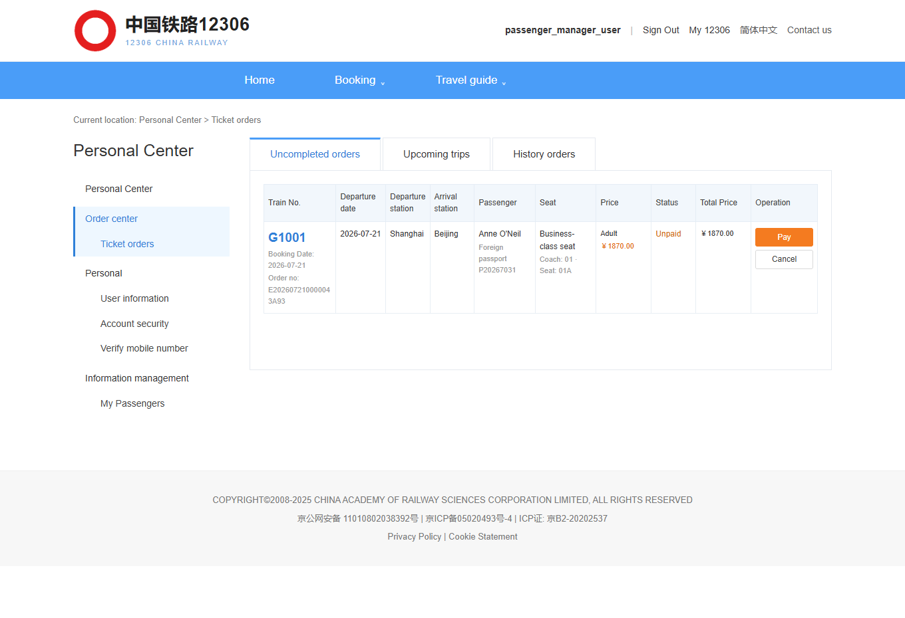

# Uncompleted orders show city names in the station columns

White-box test · [REQ-5.3.2, REQ-3.6.2, REQ-3.6.3](../../requirements/requirements.yaml)

## Description

Uncompleted orders show city names in the station columns.

## Requirement: Expected Output

The order table specifies station columns. For this train and date, the published departure station is Shanghai Hongqiao and the arrival station is Beijing South.

## Test description

Manual reproduction in Chrome; the input was selected by reading the implementation.

The [unpaid-order baseline](../baseline/REQ-5.3.2.spec.ts) checks that the row contains Shanghai and Beijing. Both strings also occur in the full G1001 station names. In [currentOrdersTable](../../frontend/js/pages-personal.js), the station cells use city fields. Check the complete text of each cell against the same order on the payment page.

Steps:

1. Use the [passenger setup](README.md#passenger-setup) to add Anne O'Neil, passport P20267031, mobile 13800000046. Start with the G1001 business seat available for this account.
2. On the homepage search Shanghai to Beijing on 2026-07-21. Choose Book on G1001, select Anne and the business-class seat, then Place order and Confirm.
3. Read both stations in Order details. Leave the order unpaid. Open My 12306 → Order center → Ticket orders → Uncompleted orders. Locate the same train and passenger and read Departure station and Arrival station.

## Observed Output

The payment page showed Shanghai Hongqiao and Beijing South. The order table showed Shanghai and Beijing.

## Evidence

