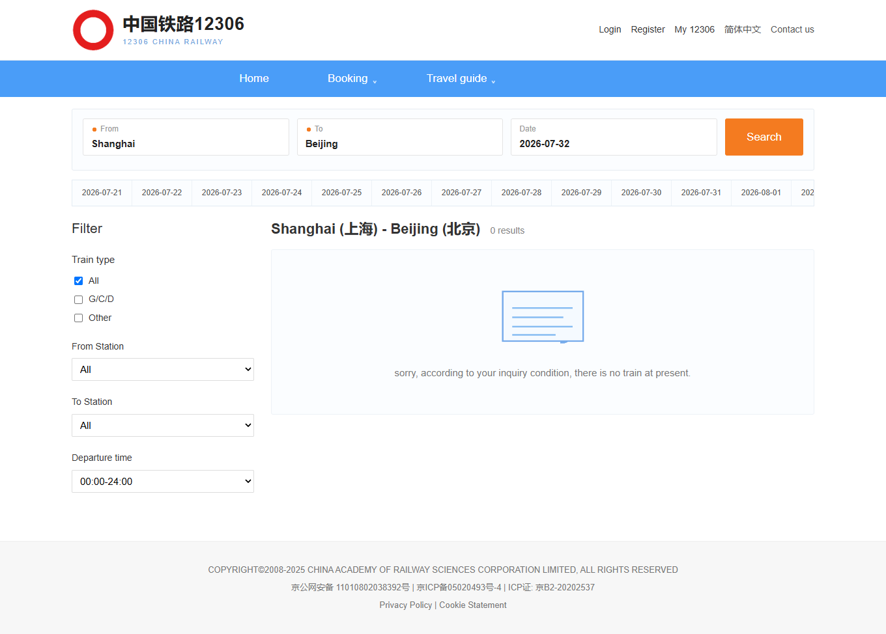

# Train search accepts July 32 as a departure date

Black-box test · [REQ-3.1.3](../../requirements/requirements.yaml)

## Description

Train search accepts July 32 as a departure date.

## Requirement: Expected Output

The allowed travel days run from July 21 through August 4. July 32 is outside this set and should be rejected on the form. The test does not require specific wording for this input.

## Test description

Manual reproduction in Chrome; the input was designed from the requirement and the baseline specification, without reading the implementation.

The [date baseline](../baseline/REQ-3.1.3.spec.ts) tests a selectable day and calendar dates immediately outside the sale period. This input has the expected textual shape and sorts between the endpoints, but denotes no calendar day.

Steps:

1. On the signed-out homepage, fill From with Shanghai and To with Beijing.
2. Type 2026-08-05 in Date and click Search. Observe the sale-window error.
3. Keep the same route, manually enter 2026-07-32 and click Search again.

## Observed Output

August 5 was rejected. July 32 opened the results page with 2026-07-32 still in the Date field and a count of zero.

## Evidence

