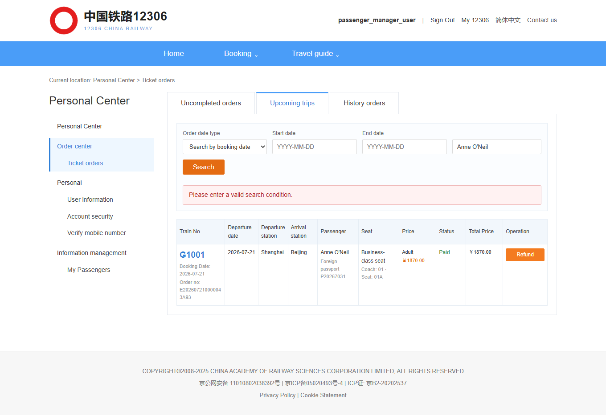

# Upcoming trips rejects the full name of a booked passenger

Black-box test · [REQ-5.4.3](../../requirements/requirements.yaml)

## Description

Upcoming trips rejects the full name of a booked passenger.

## Requirement: Expected Output

The requirement allows fuzzy searches by passenger name. A complete name displayed on the order should also retrieve that order. The requirement gives *** as an invalid example and does not explicitly discuss apostrophes.

## Test description

Manual reproduction in Chrome; the input was designed from the requirement and the baseline specification, without reading the implementation.

The [upcoming-trip baseline](../baseline/REQ-5.4.3.spec.ts) checks date ranges, a nonmatching keyword and the invalid string ***. This test uses a name already accepted for a booking and compares it with a matching fragment.

Steps:

1. Use the [passenger setup](README.md#passenger-setup) to add Anne O'Neil, passport P20267031, mobile 13800000046. Use an ordinary ASCII apostrophe. Start with the G1001 business seat available.
2. Search Shanghai to Beijing on 2026-07-21. Book G1001 for Anne in business class. Choose Place order, Confirm and Pay in the course application.
3. Open Ticket orders → Upcoming trips. Leave dates empty. Search for Neil, then search for Anne O'Neil.

## Observed Output

Neil retrieved the order. Searching for the complete name displayed “Please enter a valid search condition.” The previous result remained visible. The validation message identifies the failure.

## Evidence

