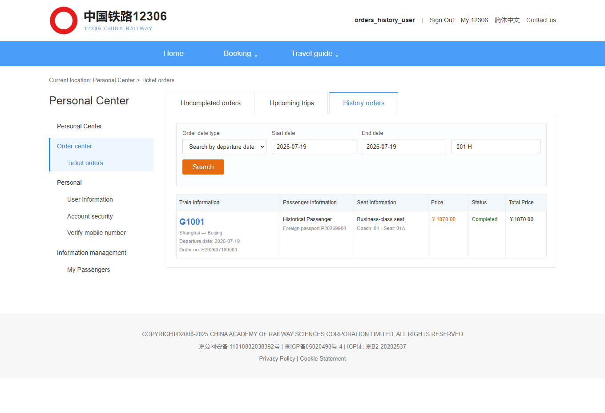

# History search matches text spanning the train number and passenger name

White-box test · [REQ-5.7.3](../../requirements/requirements.yaml)

## Description

History search matches text spanning the train number and passenger name.

## Requirement: Expected Output

REQ-5.7.3 describes a fuzzy keyword search by order number, train number or passenger name. No individual field contains the fragment 001 H, so the result should remain empty under the field-wise reading of this requirement.

## Test description

Manual reproduction in Chrome; the input was selected by reading the implementation.

The [history baseline](../baseline/REQ-5.7.3.spec.ts) excludes a nonmatching keyword, Z9999. In [query_orders](../../backend/app.py), the implementation joins the order number, train number and names with spaces before testing for a substring. This case places the keyword across a join boundary.

Steps:

1. Sign in as orders_history_user with Password123! and open My 12306 → Order center → Ticket orders → History orders. Use the supplied completed order E202607180001, train G1001, passenger Historical Passenger.
2. Select Search by departure date. Set both Start date and End date to 2026-07-19. Enter `001 Z` in Order number/train number/name and click Search. Confirm the empty result.
3. Change only the keyword to `001 H` and search again. Compare it separately with each displayed searchable field.

## Observed Output

001 Z returned no orders. 001 H returned G1001. The fragment is formed by the end of G1001, an inserted space and the first letter of Historical Passenger.

## Evidence

