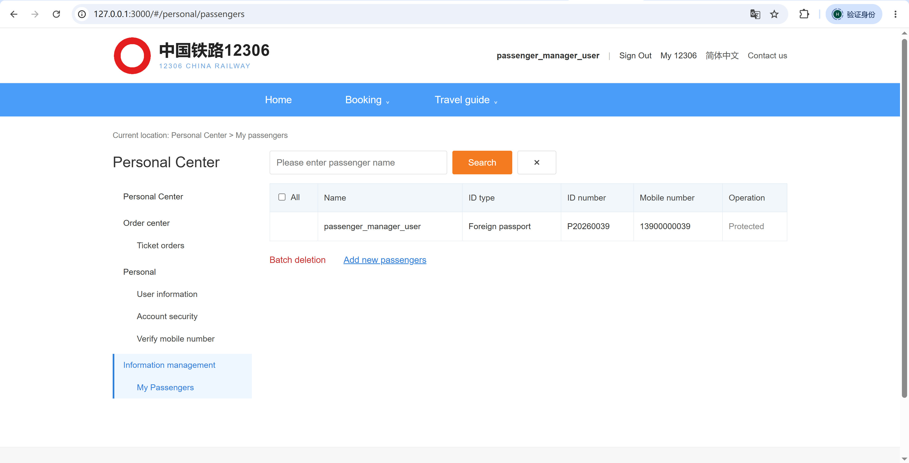
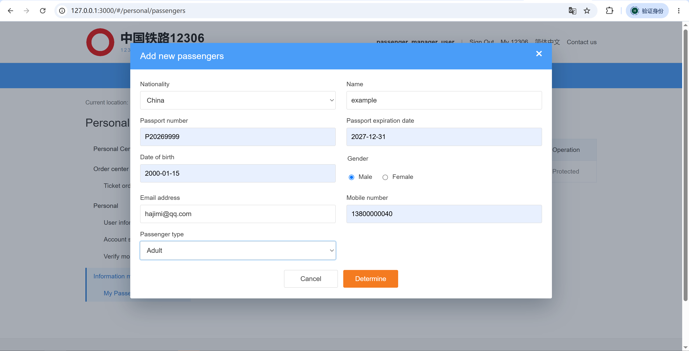
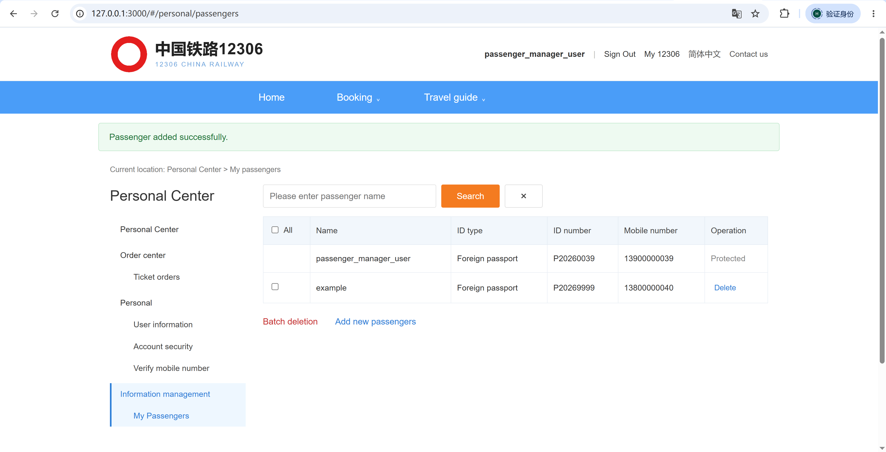
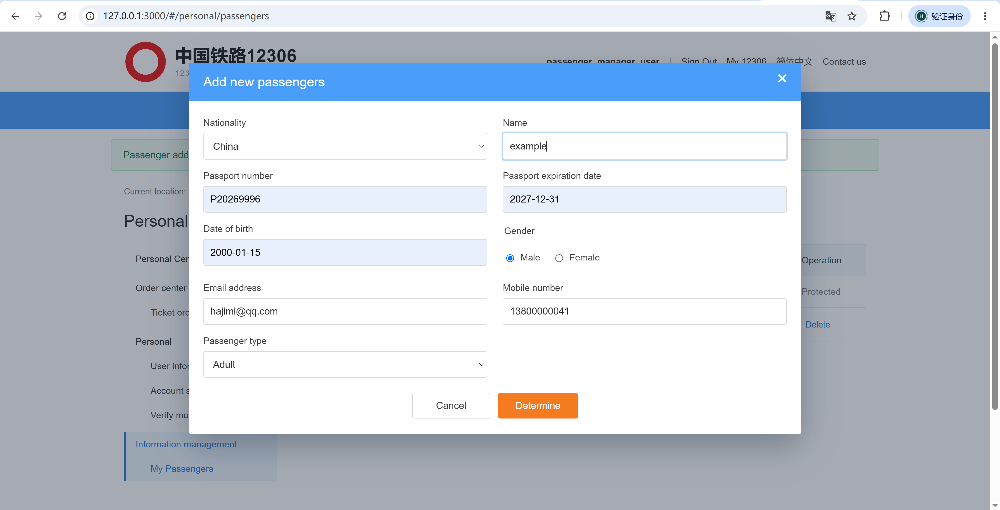
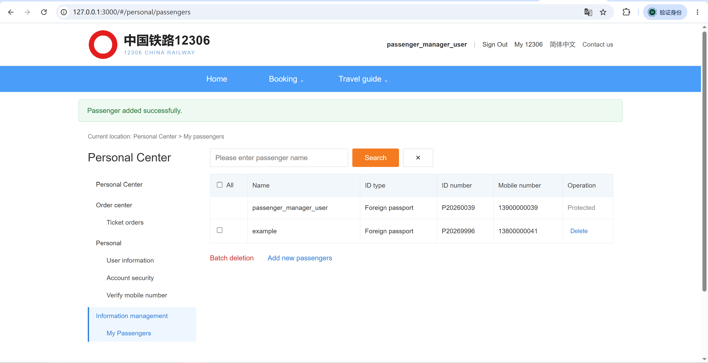

# Adding a passenger with an existing name replaces the saved record

White-box test · [REQ-7.1, REQ-7.2](../../requirements/requirements.yaml)

## Description

The Add new passengers dialog identifies a passenger by name, so saving a second
passenger that shares a name with an existing row overwrites that row instead of
adding a new one. The passport saved earlier is lost.

## Requirement: Expected Output

REQ-7.2 requires that Determine with valid values adds a persistent passenger and
shows `Passenger added successfully.`, and REQ-7.1 makes the name and passport
identities of a record independently identifiable visible text. A different
passport identifies a different traveller, and the REQ-7 subtree defines no
edit-passenger capability, so saving `example` with passport P20269999 and then
`example` with passport P20269996 must leave two rows. REQ-7.2 also states
unconditionally that a duplicate passport shows `Passport number already exists.`.

## Test description

Manual reproduction in Chrome; the input was selected by reading `_passenger_add`,
so this case is white-box.

The [baseline](../baseline/REQ-7.2.spec.ts) adds a brand-new name and rejects a
duplicate passport under a different name. In [_passenger_add](../../backend/app.py)
a `same_name` query matches the account's non-holder rows by name; when it matches,
the handler updates that row including its passport and returns success. The
baseline never reaches that branch.

Steps:

1. Sign in as `passenger_manager_user` / `Password123!` and open My 12306 →
   My passengers. Only the protected account-holder row is present.
2. Add new passengers: Nationality China, Name `example`, Passport number
   `P20269999`, Passport expiration date `2027-12-31`, Date of birth `2000-01-15`,
   Gender Male, Email address `hajimi@qq.com`, Mobile number `13800000040`,
   Passenger type Adult. Click Determine and confirm the row.
3. Open Add new passengers again with the same Name `example`, the unused passport
   `P20269996`, mobile `13800000041`, and every other field as in step 2. Click
   Determine.
4. Reload My passengers and look for both passports.

## Observed Output

The dialog closed with `Passenger added successfully.` and the table still held a
single passenger row. `example` / P20269999 had been replaced by `example` /
P20269996, so the earlier passport was no longer stored and the row count never
increased. Repeating step 3 with the already used passport P20269999 instead of a
new one also returned `Passenger added successfully.` rather than the
`Passport number already exists.` required by REQ-7.2.

## Evidence

