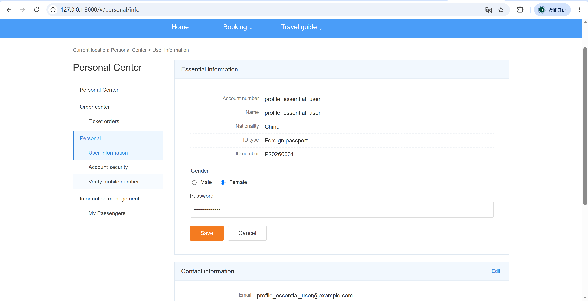
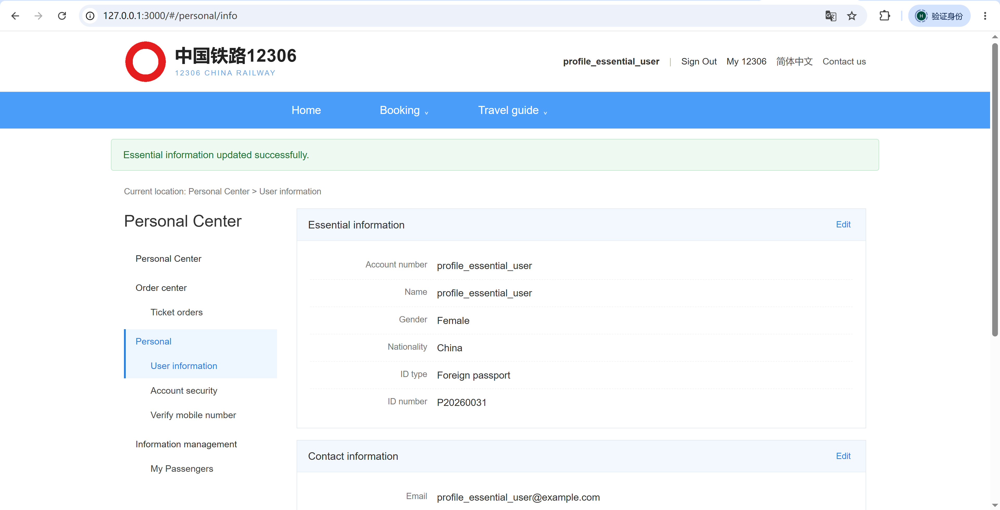
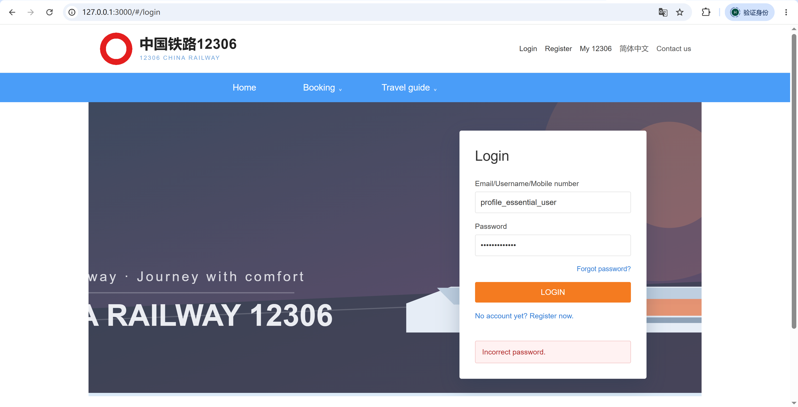

# Saving Essential information discards the submitted password

White-box test · [REQ-6.2](../../requirements/requirements.yaml)

## Description

The Essential information edit form collects a password, validates its length and
then never uses it, so saving the form changes the gender but leaves the login
password untouched.

## Requirement: Expected Output

REQ-6.2 states that `profile_essential_user` starts Male with `Password123!` and
may save Female with `Password123!X`. Because the password named for the save is
not the start-state login password, the field cannot be a re-confirmation of the
current password: the only consistent reading is that it carries the new login
password, which the successful save applies. After a successful save,
`Password123!X` should authenticate the account and `Password123!` should not.

## Test description

Manual reproduction in Chrome; the case was selected by reading `_save_essential`,
so it is white-box.

The [baseline](../baseline/REQ-6.2.spec.ts) fills `bad` and expects
`Please enter a valid password.` — only the rejection branch. In
[_save_essential](../../backend/app.py) the local `password` is read once for a
length check and then never reaches `password_hash()` or the `UPDATE`, which writes
only `gender`. The success branch is never exercised by the baseline, and no
baseline test checks whether the submitted password has any effect.

Steps:

1. Sign in as `profile_essential_user` / `Password123!` and open My 12306 →
   User information (`#/personal/info`). Essential information shows Gender Male.
2. Inside Essential information click Edit. Set Gender to Female, type
   `Password123!X` in the Password field and click Save. Note the message and the
   displayed gender.
3. Return Home and click Sign Out.
4. Try to sign in as `profile_essential_user` with `Password123!X`, then with
   `Password123!`.

## Observed Output

The save reported `Essential information updated successfully.` and Gender was
displayed as Female, so the success branch ran. Signing in with `Password123!X`
was rejected with `Incorrect password.`, while the original `Password123!` still
authenticated the account: the submitted password had no effect at all and was
neither verified nor applied.

## Evidence

